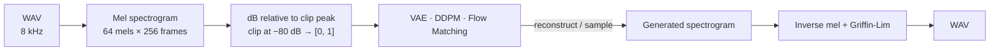
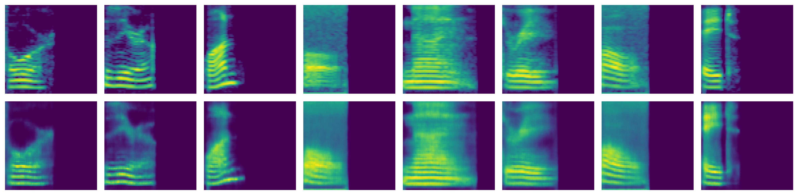
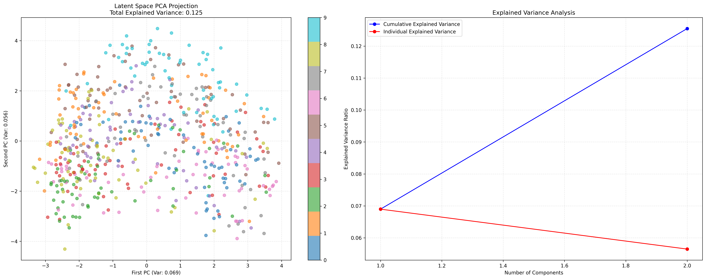
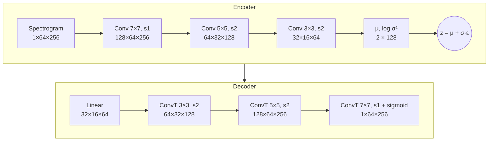
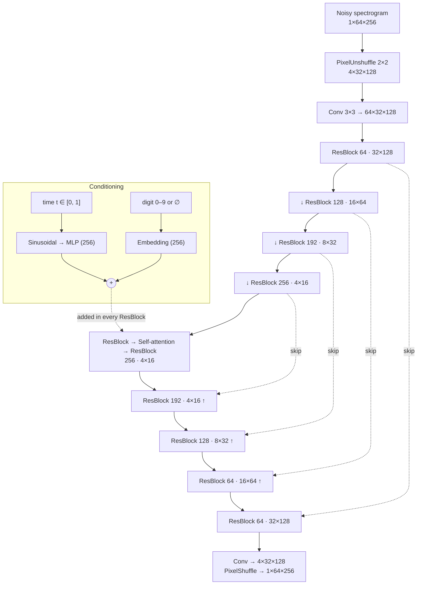
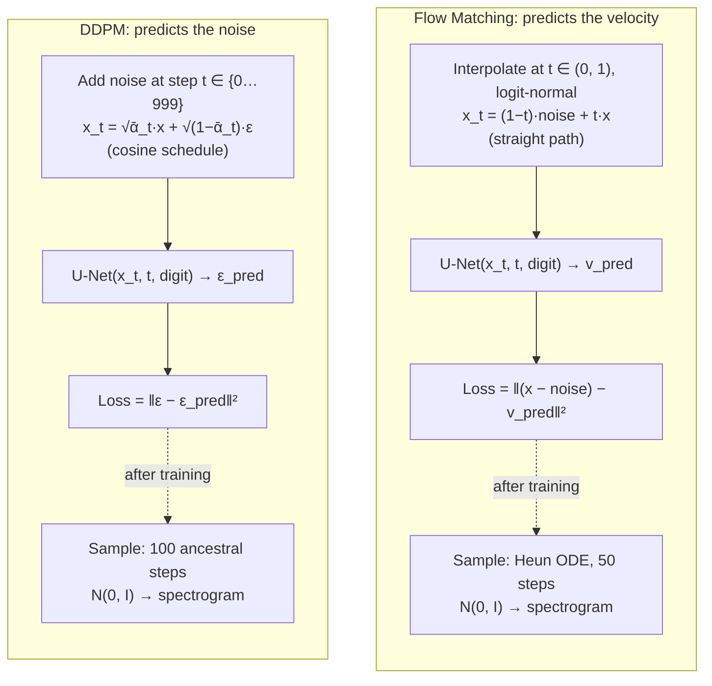
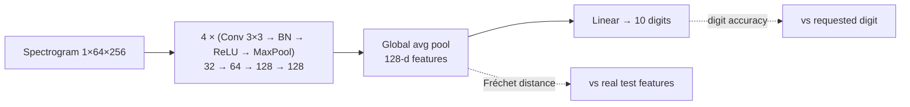

# sound-generation-via-vae

Generating spoken digits from mel spectrograms with three generative models in PyTorch: a **convolutional VAE**, a **DDPM** (denoising diffusion) and **Flow Matching**. All three share one spectrogram pipeline.

Raw audio has too many samples per second to model directly. Each recording becomes a small mel spectrogram (64 × 256), the models learn that image, and Griffin-Lim turns generated spectrograms back into audio.



## Results

All models are trained on the [Free Spoken Digit Dataset](https://github.com/Jakobovski/free-spoken-digit-dataset): 3,000 recordings of the digits 0–9 from 6 speakers. The splits are 2,160 clips for training, 240 for validation and 600 for testing.

### Generation: VAE vs DDPM vs Flow Matching

<!-- results:generation -->
_Filled in by `evaluate_generative.py`._
<!-- /results:generation -->

- **Fréchet distance:** distance between generated and real test spectrograms in the feature space of a digit classifier trained on real data (as in FID and FAD). Lower is better.
- **Digit accuracy:** how often that classifier hears the digit that was requested. The VAE is unconditional, so it has no score here.
- **Speed:** measured on an RTX 5000 in batches of 100. DDPM and Flow Matching both use 100 network evaluations per sample, plus classifier-free guidance (scale 2).

One sample per digit (uncurated; the VAE row is random digits):


The confusion matrices show which digit each model actually produced for every requested digit:


### VAE reconstruction

<!-- results:vae -->
_Filled in by `evaluate_generative.py`._
<!-- /results:vae -->





### Audio samples

Listen in [`free_spoken_digit/samples/`](free_spoken_digit/samples):

| Folder | Contents |
|---|---|
| `ddpm/`, `flow/` | One generated clip per digit (`digit_0.wav` … `digit_9.wav`) |
| `sampled_from_prior/` | VAE samples decoded from random latents z ~ N(0, I) |
| `generated/` | VAE reconstructions of real clips |
| `original/` | The original spectrograms converted straight back to audio, the upper bound on quality |

## Architectures

### VAE



Each encoder block is Conv → ReLU → BatchNorm → Dropout. Training adds Gaussian noise to the input (σ = 0.05, i.e. a denoising VAE) and uses a BCE reconstruction loss plus a KL term warmed up over 20 epochs. At inference the model decodes μ directly.

### U-Net (shared by DDPM and Flow Matching)



- **ResBlock:** GroupNorm → SiLU → Conv, add the embedding, then GroupNorm → SiLU → Dropout → Conv, plus a residual connection. Total 8.4M parameters.
- **Pixel-unshuffle:** folds 2×2 pixel patches into channels, so the network runs at 32×128 while still predicting every pixel. This is about 3.7× faster than full resolution.
- **Classifier-free guidance:** labels are dropped to ∅ 10% of the time during training. Sampling uses `uncond + 2·(cond − uncond)`.

### DDPM vs Flow Matching

Both wrap the same U-Net and differ only in what it learns to predict, and how samples are drawn.



### Evaluation classifier



## Usage

```bash
pip install -r requirements.txt
export PYTHONPATH=.        # run everything from the repo root
```

Set the dataset paths and all hyperparameters in [`free_spoken_digit/configs.py`](free_spoken_digit/configs.py). Every VS Code launch entry is in [`.vscode/launch.json`](.vscode/launch.json).

Run everything end to end (VAE → DDPM → Flow Matching → comparison report). In VS Code, this is the **Pipeline: all methods + report** launch entry:

```bash
python free_spoken_digit/run_pipeline.py                     # all stages
python free_spoken_digit/run_pipeline.py --from ddpm --resume  # continue an interrupted stage, then the rest
```

Or run the stages one by one:

```bash
python free_spoken_digit/main.py --generate-spectrograms                  # once: audio -> spectrograms
python free_spoken_digit/main.py --train                                  # VAE (early stopping)
python free_spoken_digit/main.py --test                                   # VAE figures -> assets/
python free_spoken_digit/create_audios.py                                 # VAE .wav samples
python free_spoken_digit/train_generative.py --method ddpm --train --sample
python free_spoken_digit/train_generative.py --method flow --train --sample
python free_spoken_digit/evaluate_generative.py                           # comparison table + figures
```

**Stopping and resuming.** Press Ctrl+C at any time. The VAE keeps its state from the last finished epoch, and DDPM and Flow Matching save the current step. Add `--resume` to continue exactly where training stopped: model, EMA, optimizer, learning-rate schedule, early-stopping counter, history and random-number state are all restored. Resume state lives in `free_spoken_digit/checkpoints/*_resume.pt` and `vae_free_spoken_digit_latest.pt`.

Every run logs to the console and to `logs/<run>_<timestamp>.log`. The logs of the runs behind these results are in [`logs/`](logs). Pretrained weights for every model are in `free_spoken_digit/checkpoints/`.

## Design notes

- **Native 8 kHz audio.** The recordings are 8 kHz. Resampling to 22.05 kHz would leave every mel bin above 4 kHz empty.
- **Per-clip peak normalization.** dB values are taken relative to each clip's own peak and clipped at −80 dB. Recording gain varies by about 30 dB between speakers, and the output audio is peak-normalized anyway, so absolute level carries no information. Because every clip shares the same [−80, 0] dB range, any generated spectrogram can be inverted without per-file statistics.
- **Early stopping everywhere.**
  - VAE: patience of 15 epochs after KL warm-up.
  - DDPM and Flow Matching: 5 validations (10k steps) on the EMA model, capped at 60k steps.
  
  Only the best checkpoint is kept.
- **Training efficiency.** The whole dataset sits on the GPU, with mixed precision, EMA weights (decay 0.9995) and gradient clipping.
- **Reproducibility.** Seeds are fixed, cuDNN is deterministic, and all settings live in `configs.py`.
- **Lossy inversion.** Mel spectrograms discard phase, which Griffin-Lim estimates, so even real spectrograms sound slightly metallic when converted back to audio.

## Project layout

```
arch/               VAE, U-Net and evaluation-classifier networks
generative/         DDPM and Flow Matching (loss + sampler)
training/           VAE trainer, generative trainer, early stopping
common/             Seeding, logging, metrics and plotting helpers
free_spoken_digit/  Spectrogram pipeline, configs, training / sampling / evaluation scripts
mnist/              MNIST example of the VAE
logs/               Training logs of the published models
```

## Contributors

- [wajihullahbaig](https://github.com/wajihullahbaig)
- [Claude](https://claude.com/claude-code) (Anthropic): spectrogram pipeline and normalization, DDPM and Flow Matching, evaluation, training fixes

## Acknowledgements

The VAE part was inspired by Valerio Velardo's [Generating Sound with Neural Networks](https://www.youtube.com/watch?v=Ey8IZQl_lKs&list=PL-wATfeyAMNpEyENTc-tVH5tfLGKtSWPp) series.
