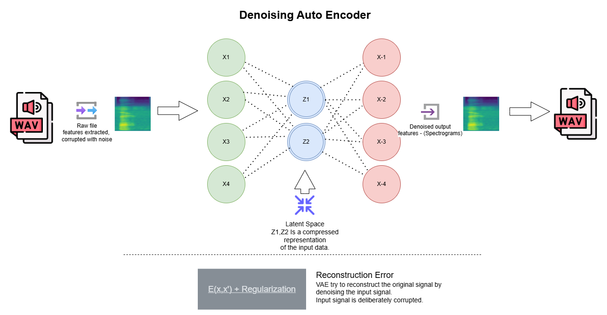

# sound-generation-via-vae

A convolutional (denoising) Variational Autoencoder in PyTorch that learns to reconstruct and generate spoken digits from mel spectrograms.

Raw audio has too many samples per second to model directly. This project converts each recording into a small mel spectrogram (64 × 256). The VAE learns that image, and Griffin-Lim turns spectrograms back into audio.



## Results

The model is trained on the [Free Spoken Digit Dataset](https://github.com/Jakobovski/free-spoken-digit-dataset): 3,000 recordings of the digits 0–9 from 6 speakers.

| Model | Mean spectrogram error on test-set speech (dB) |
|---|---|
| Previous model (22.05 kHz, per-file normalization) | 4.15 |
| **Current model** (8 kHz, global normalization) | **2.61** |

Test-set reconstructions: original on top, VAE output below.


Latent space, projected with PCA and colored by digit:


### Audio samples

Listen in [`free_spoken_digit/samples/`](free_spoken_digit/samples):

- `original/` contains the original spectrogram converted back to audio. This is the upper bound on quality.
- `generated/` contains the same clips encoded and decoded by the VAE.
- `sampled_from_prior/` contains new sounds decoded from random latent vectors, z ~ N(0, I).

## Usage

```bash
pip install -r requirements.txt
# Run from the repo root with the repo on PYTHONPATH
export PYTHONPATH=.
```

Set the dataset paths and all hyperparameters in [`free_spoken_digit/configs.py`](free_spoken_digit/configs.py). Training and audio generation share this file.

```bash
python free_spoken_digit/main.py --generate-spectrograms   # once: audio -> normalized spectrograms
python free_spoken_digit/main.py --train                   # train; exports best weights to checkpoints/
python free_spoken_digit/main.py --test                    # plot reconstructions and latent space
python free_spoken_digit/create_audios.py                  # write reconstructed and generated .wav files
```

A pretrained model is included at `free_spoken_digit/checkpoints/vae_free_spoken_digit_8k.pt`.

The MNIST version of the same VAE is in [`mnist/`](mnist): run `python mnist/main.py`.

## Design notes

- **Native 8 kHz audio.** The recordings are 8 kHz. Resampling to 22.05 kHz would leave every mel bin above 4 kHz empty.
- **Global dB normalization.** All spectrograms share one dB range, with an 80 dB floor. Any decoded spectrogram, including one sampled from the prior, can therefore be turned back into audio without per-file statistics.
- **Training.** Input noise (denoising VAE), KL warm-up over the first 20 epochs, gradient clipping, and a reduce-on-plateau learning-rate schedule. The decoder has no dropout, which keeps harmonics sharp.
- **Deterministic inference.** At evaluation time the model adds no input noise and decodes the latent mean.
- **Lossy inversion.** Mel spectrograms discard phase, which Griffin-Lim estimates. Even the original spectrogram sounds slightly metallic when converted back to audio.

## Project layout

```
arch/               VAE encoder/decoder and input-noise transform
training/           Trainer (loss, KL warm-up, checkpoints)
common/             Seeding and plotting helpers
free_spoken_digit/  Spectrogram pipeline, configs, training and audio scripts
mnist/              MNIST example
```

## Contributors

- [wajihullahbaig](https://github.com/wajihullahbaig)
- [Claude](https://claude.com/claude-code) (Anthropic): 8 kHz spectrogram pipeline, global normalization, training and inference fixes, prior sampling

## Acknowledgements

Inspired by Valerio Velardo's [Generating Sound with Neural Networks](https://www.youtube.com/watch?v=Ey8IZQl_lKs&list=PL-wATfeyAMNpEyENTc-tVH5tfLGKtSWPp) series.
