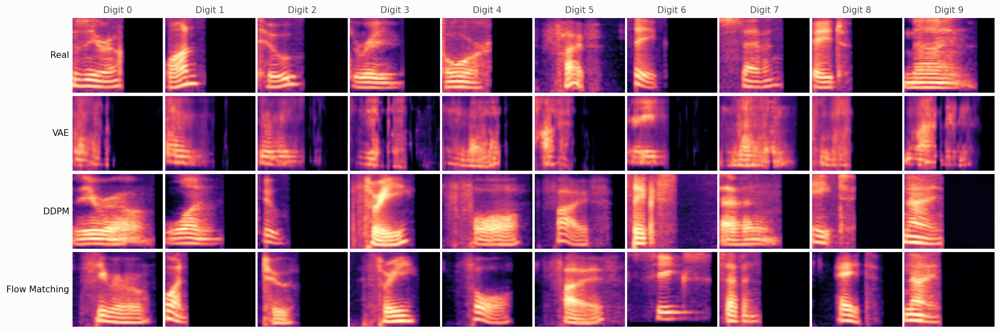
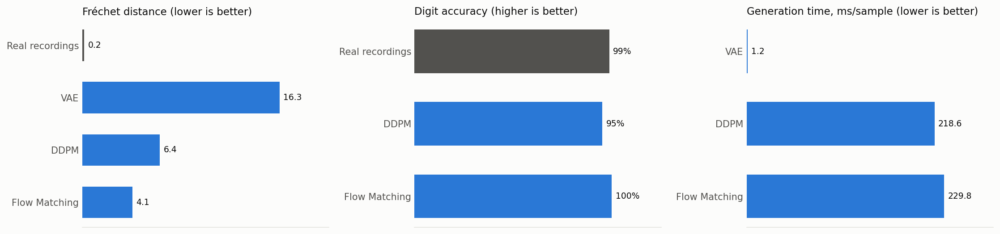
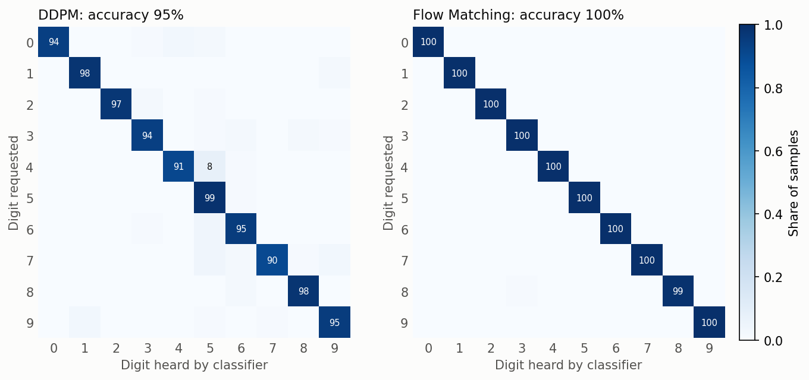
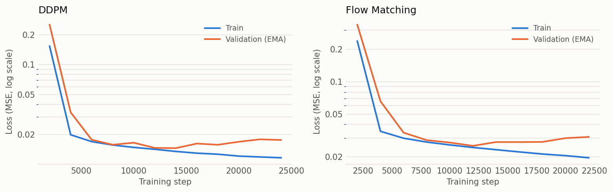
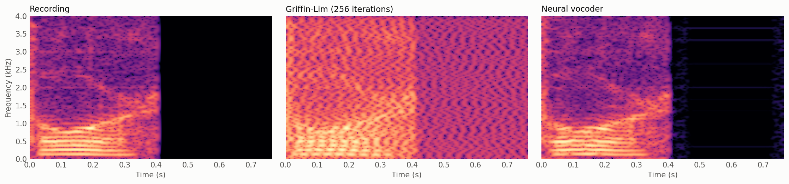

# Comparison report: VAE vs DDPM vs Flow Matching for spoken-digit generation

This report compares three generative models trained on identical spectrograms, and two ways of turning spectrograms back into audio. Every number comes from the logged runs in [`logs/`](logs) and the JSON files in [`assets/`](assets). The code that produced them is in this repository, and the **Pipeline: all methods + vocoder + report** launch entry reruns everything.

## Summary

- **Flow Matching wins on realism and intelligibility.** It reaches a Fréchet distance of **4.13** with **99.9%** digit accuracy, about 4× closer to real speech than VAE prior samples (16.26) and ahead of DDPM (6.39 / 95.1%). It does this with the same network, the same compute per sample and less training.
- **DDPM and Flow Matching tie on perceived audio quality.** In a blind listening test (30 clips each), they scored **4.00 vs 4.13 / 5** (p = 0.59). Flow Matching produced more perfect clips but slightly more failures. The classifier metrics measure *which digit* and *how realistic the spectrogram*, not *how good it sounds*, so both views are needed.
- **Both diffusion-style models far exceed the VAE in sample quality.** Their spectrograms show sharp harmonics and realistic onsets. VAE prior samples are blurry and contain artefacts.
- **The neural vocoder removes the robotic sound.** Speech quality (PESQ) rises from **1.97 to 3.42**, and rendering is **33× faster** than Griffin-Lim (10 ms vs 336 ms per clip on the CPU).
- **Early stopping mattered.** Both diffusion models began to overfit the 2,160 training clips after about 12–14k steps, and stopping kept the best weights.
- **The VAE is still useful for speed:** it samples in about 1 ms, roughly 200× faster than DDPM or Flow Matching.

## Setup

| | |
|---|---|
| **Data** | Free Spoken Digit Dataset: 3,000 clips, 6 speakers, digits 0–9, 8 kHz |
| **Splits** | 2,160 train / 240 validation / 600 test, stratified by digit (identical for every model) |
| **Representation** | 64 mels × 256 frames (0–4 kHz, 3 ms hop), in dB relative to each clip's own peak and clipped at −80 dB |
| **Hardware** | Laptop RTX 5000 Max-Q (16 GB). It throttled to 300 MHz for part of the Flow Matching run (see *Training cost*) |
| **Seeds** | Fixed seed (111), deterministic cuDNN |

| Model | Parameters | What it learns | Sampling |
|---|---|---|---|
| VAE | 13.1M | Encoder–decoder with a 128-d latent, BCE + KL (warm-up) | Decode z ~ N(0, I); unconditional |
| DDPM | 8.4M | U-Net predicts the added noise ε (cosine schedule, 1000 steps) | 100 ancestral steps, classifier-free guidance 2.0 |
| Flow Matching | 8.4M | Same U-Net predicts the velocity on a straight noise → data path | Heun ODE, 50 steps (100 network calls), guidance 2.0 |
| Vocoder | 3.3M | Vocos-style: mel → STFT magnitude + phase → inverse STFT; GAN-trained | One forward pass |

DDPM and Flow Matching share **the exact same U-Net, data, optimizer, EMA, batch size and number of network calls per sample**. The only difference between them is the training objective and the sampler.

## 1. Generation quality

| Model | Fréchet distance ↓ | Digit accuracy ↑ | ms / sample ↓ |
|---|---|---|---|
| Real recordings (reference) | 0.17 | 98.7% | — |
| VAE (prior samples) | 16.26 | — | 1.2 |
| DDPM | 6.39 | 95.1% | 218.6 |
| Flow Matching | **4.13** | **99.9%** | 229.8 |

1,000 samples per model (100 per digit for the conditional models) are scored by a small CNN digit classifier trained only on real training clips. It reaches 98.7% accuracy on real test clips.
- **Fréchet distance:** distance between the feature distributions of generated and real test spectrograms, as in FID and FAD.
- **Reference row:** the real training clips scored against the real test clips (0.17), i.e. the best achievable distance.

**Reading the grid** (one uncurated sample per digit):
- **VAE:** blurry harmonics, vertical streak artefacts and smeared word endings. This is the classic VAE averaging effect.
- **DDPM:** sharp harmonics and realistic formant motion, but some samples are too long or too dense; digit 4 is visibly "5-like".
- **Flow Matching:** sharp, well-timed samples that are closest to the real row.

## 2. Which digits fail?

- **Flow Matching** is essentially perfect: 99.9% overall, with the only misses on digit 8.
- **DDPM** makes systematic mistakes: **"4" heard as "5" in 8%** of samples, and its weakest digits are 7 (90%), 4 (91%), 0 and 3 (94%). "Four" and "five" share an initial /f/ and a diphthong-like vowel, so this is the confusion you would expect when the class signal is weak.
- Flow Matching's higher accuracy at the same guidance scale suggests that its straight-path velocity target learns the class-conditional structure more reliably on this small dataset.

## 3. Training dynamics and overfitting

On the log scale, both diffusion models show the same pattern: training loss keeps falling while EMA validation loss bottoms out (DDPM at step 14k, Flow Matching at 12k) and then rises. With only 2,160 clips the models start to memorize, and early stopping (patience: 5 validations = 10k steps) kept the best weights.

## 4. Spectrogram → audio: Griffin-Lim vs neural vocoder

Both methods render the **real test spectrograms** and are scored against the **true recordings**:

| Method | PESQ (narrowband, 1–4.5) ↑ | STOI (0–1) ↑ | ms / clip (CPU) ↓ |
|---|---|---|---|
| Griffin-Lim (256 iterations) | 1.97 | 0.416 | 336.0 |
| Neural vocoder | **3.42** | **0.484** | **10.2** |

- **Why Griffin-Lim sounds robotic:** a mel spectrogram keeps how loud each frequency is and drops the phase. Griffin-Lim *guesses* the phase iteratively. In the figure, its harmonics are smeared into a wavy texture and the silent tail is filled with noise.
- **What the vocoder does differently:** it *learned* phase from real speech. Its output is almost indistinguishable from the recording; only a few very faint hop-rate lines remain in silence.
- **PESQ 3.42 vs 1.97** is the difference between "fair–good" and "poor" speech quality on the ITU-T P.862 scale.
- **Speed:** the vocoder runs at frame rate with one inverse FFT, so it is 33× faster than 256 Griffin-Lim iterations, even on the CPU.

All audio in [`free_spoken_digit/samples/`](free_spoken_digit/samples) is now rendered with the vocoder. [`vocoder_comparison/`](free_spoken_digit/samples/vocoder_comparison) has recording / Griffin-Lim / vocoder triplets of the same test clips.

## 5. VAE reconstruction

The current VAE reconstructs test spectrograms with a **3.69 dB** mean error in speech regions (2.23 dB over all bins).

This is higher than the earlier global-normalization VAE (2.61 dB), but the two numbers are **not comparable**. The old normalization clipped quiet speakers' low-level detail to the floor, which is trivially easy to reconstruct. Per-clip normalization keeps the full 80 dB below every clip's peak, so the same "speech" region now contains much more quiet detail. 3.69 dB is the honest baseline for future changes.

## 6. Blind listening test

The classifier metrics can't hear sound quality, and an initial informal listen suggested DDPM sounded better. To settle it:
- **Clips:** 30 fresh samples per model (3 per digit, a seed not used anywhere else), all rendered with the same vocoder.
- **Blinding:** shuffled and anonymised, with the key kept out of reach.
- **Rating:** overall quality from 1 (bad) to 5 (excellent).

| Model | Mean score ↑ | 95% CI | Rated 5 | Rated ≤ 2 |
|---|---|---|---|---|
| DDPM | 4.00 | 3.53–4.43 | 53% | 13% |
| Flow Matching | 4.13 | 3.63–4.57 | 60% | 17% |

The difference is **−0.13 (95% CI −0.80 to +0.57, Mann-Whitney U p = 0.59)**, so there's **no detectable difference** in perceived quality.

- **The two models fail differently.** Flow Matching's low ratings cluster on digits 2 and 1 (two of its three "2" samples scored 1). DDPM's are spread across digits 1, 6, 7 and 8.
- **Flow Matching is higher-variance:** more excellent clips and slightly more failures.
- **Small sets mislead.** The informal impression came from the 10 published samples per model (one per digit), where a single weak clip carries a lot of weight.

Per-clip unblinded ratings are in [`assets/listening_test_results.json`](assets/listening_test_results.json).

## Training cost

| Model | Best checkpoint | Stopped at | Wall time | Note |
|---|---|---|---|---|
| VAE | epoch 112 | epoch 127 (early stop) | 2 h 22 min | ~1.1 min/epoch |
| DDPM | step 14,000 | step 24,000 (early stop) | 55 min | ~130 ms/step |
| Flow Matching | step 12,000 | step 22,000 (early stop) | 3 h 29 min | GPU throttled to 300 MHz for much of the run; ~50 min unthrottled (133 ms/step) |
| Vocoder | step 19,000 | step 25,000 (early stop) | 47 min | 24 ms/step in warm-up, ~120 ms/step with the GAN losses |

## Limitations

- **One classifier judges everything.** Fréchet distance and accuracy depend on a single small classifier, and FD is estimated from 600 test clips in 128-d. The model ranking is large and consistent across both metrics, but small FD differences shouldn't be over-read.
- **Memorization is not measured.** With 2,160 clips, generated samples may be close to training clips. A nearest-neighbour check against the training set is the natural next metric.
- **STOI is unreliable on clips under 1 s.** It analyses 384 ms segments, and about 45% of each 0.77 s clip is padding, so only a few valid segments remain. PESQ is the primary audio metric here.
- **Single seed, no error bars** on the classifier metrics.
- **The listening test has one listener and 30 clips per model.** It can rule out a large quality gap but not a small one; a multi-listener MOS test would be needed for that.
- **Timings depend on the hardware state.** Sampling speed was measured on a partly throttled laptop GPU; relative speeds are meaningful, absolute ones are not.

## Recommended next steps

1. **Fix Flow Matching's weak digits:** inspect its "2" and "1" failures; per-class guidance or more sampling steps may help.
2. **Fewer sampling steps:** measure the speed/quality trade-off of Flow Matching at 10–25 steps. Straight paths usually degrade gracefully, which could make it about 4–10× faster.
3. **Memorization metric:** nearest-neighbour distance from each sample to the training set, compared with test-to-train distances.
4. **Quieter validation for diffusion:** validate with fixed noise and timesteps, so early stopping reacts to the model rather than to random sampling noise.
5. **Vocoder fine-tuning on generated spectrograms:** reduces the train/inference mismatch for model outputs.
6. **Light data augmentation** (time shift, gain, mild pitch shift) to delay overfitting on the small dataset.
